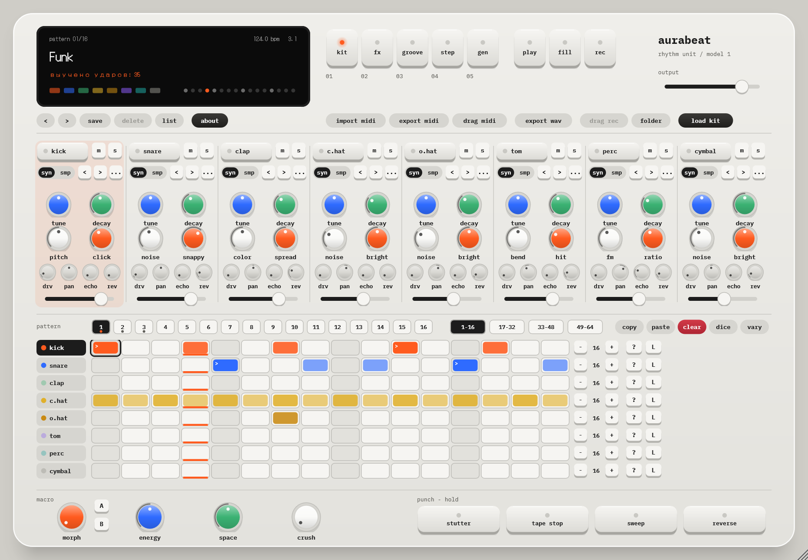
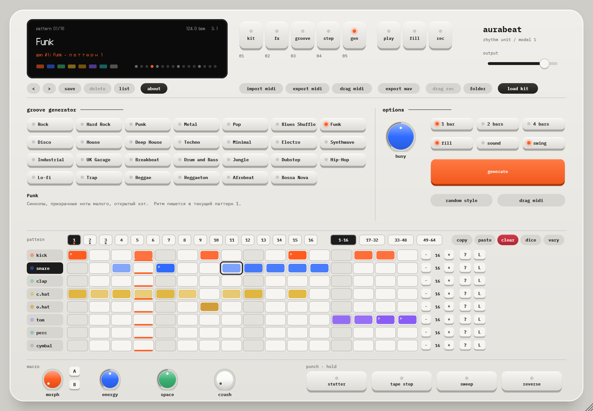
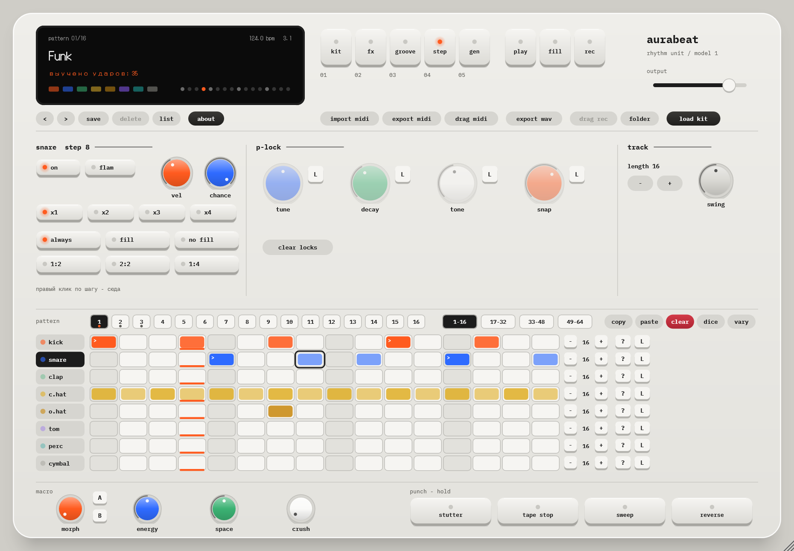
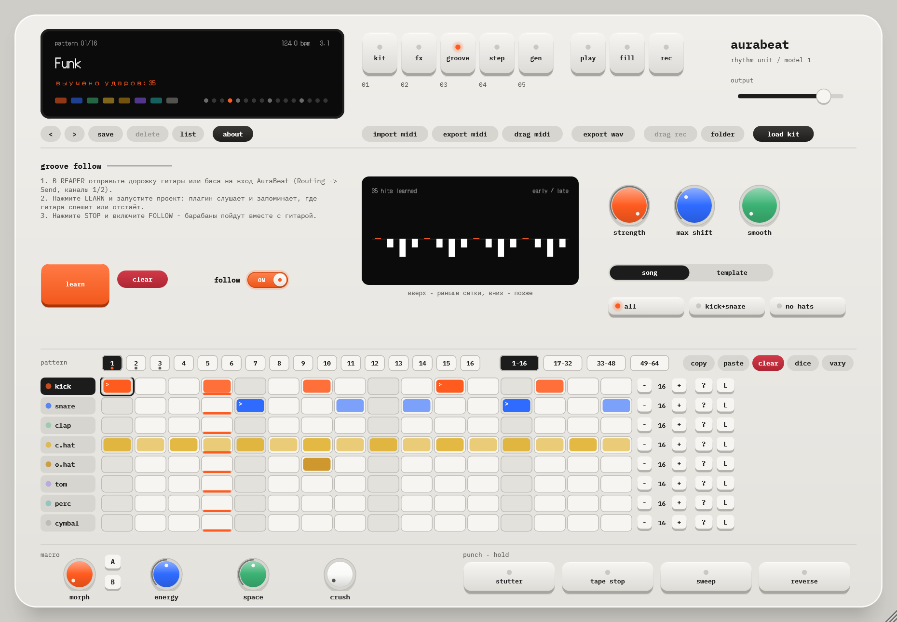
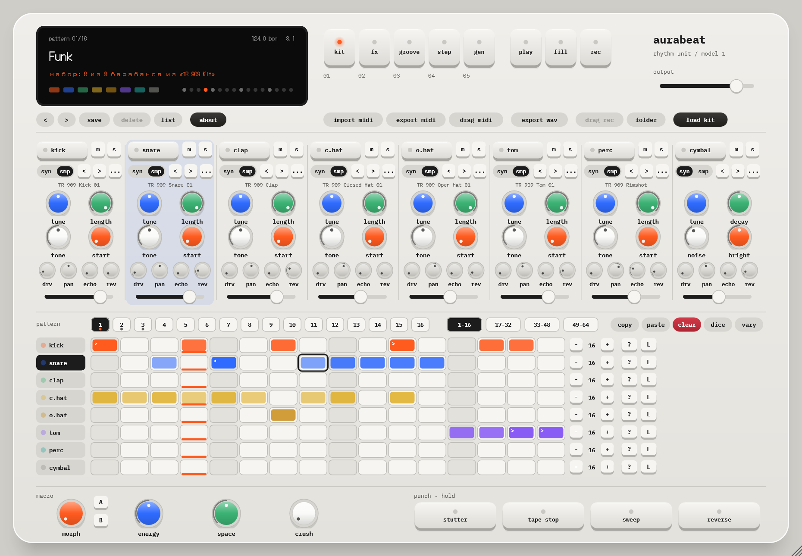

# AuraBeat — драм-машина (VST3, бесплатно)

**[⬇ Скачать AuraBeat 1.0.0 для Windows](https://github.com/papahsa101-cell/AuraBeat/raw/main/downloads/AuraBeat-Setup-1.0.0.exe)** · [Руководство (PDF)](https://github.com/papahsa101-cell/AuraBeat/raw/main/downloads/AuraBeat-Manual-RU.pdf) · [English below](#english)

Восемь барабанов, и весь звук синтезируется, без семплов: бочка, малый, хлопок, закрытый и открытый хэт, том, перкуссия и тарелка. Свои семплы тоже можно загрузить. Ритм играет вместе с проектом и в его темпе.

## Что внутри

- **Секвенсор:** 16 паттернов, до 64 шагов на дорожку, разная длина дорожек для полиритма, акценты и тихие удары.
- **Каждый шаг настраивается отдельно:** громкость, вероятность, дробь ×2–×4, флэм, условия (только в сбивке, каждый второй такт и т.д.) и своё значение высоты, длины и тембра только на этом шаге.
- **Генератор ритмов:** 27 стилей. Каждое нажатие даёт новый ритм в стиле, с регулировкой плотности, длины, сбивки и свинга.
- **Подстройка под живую гитару или бас:** плагин слушает вашу игру и сдвигает барабаны туда, где вы спешите или отстаёте.
- **Звук:** у каждого барабана высота, длина, тембр, перегруз, панорама, посылы на эхо и ревер. Общие эхо, ревер, компрессор-«склейка», фильтр и свинг.
- **Живые приёмы:** morph между двумя снимками звука, ручки energy, space и crush. Кнопки stutter, tape stop, sweep и reverse работают, пока их держите.
- **Файлы:** экспорт в WAV (целиком или каждый барабан отдельно), экспорт и импорт MIDI, перетаскивание MIDI и записи прямо на дорожку DAW.
- 10 заводских пресетов: Techno, House, Hip-Hop, Rock, Breakbeat, Trap, Electro, Minimal, Funk, Reggaeton.

| | |
|---|---|
|  |  |
|  |  |

## Установка

1. Закройте DAW.
2. Запустите `AuraBeat-Setup-1.0.0.exe`. Если Windows покажет «Система Windows защитила ваш компьютер», нажмите **Подробнее → Выполнить в любом случае**. Установщик просто не подписан платной цифровой подписью.
3. В REAPER: Options → Preferences → Plug-ins → VST → **Re-scan**. Затем Insert → Virtual instrument on new track → AuraBeat.

Плагин ставится в `C:\Program Files\Common Files\VST3\AuraBeat.vst3`. Пресеты, записи и экспорт лежат в `Документы\AuraBeat`.

**Требования:** Windows 10 или 11 (64-bit), DAW с поддержкой VST3. Есть и отдельная программа, которая работает без DAW. Интерфейс на английском, руководство на русском.

**Проверка файла (SHA-256):** `f9252e5de9938a8e9b955a97375f3692ca95d5345ecf8fdd29c9ba7643ffcb21`

## Условия

AuraBeat бесплатен. Его можно использовать в своей музыке, в том числе коммерческой. Не продавайте плагин и не выкладывайте установщик от своего имени: делитесь ссылкой на эту страницу. Программа предоставляется «как есть», без гарантий.

Все звуки барабанов синтезируются по общим принципам аналоговых драм-машин. Плагин не содержит чужих семплов, кода или данных. Шрифты IBM Plex Mono и DotGothic16 распространяются по SIL Open Font License 1.1. Плагин сделан на [JUCE](https://juce.com).

Нашли ошибку или есть идея? Пишите в [Issues](https://github.com/papahsa101-cell/AuraBeat/issues).

---

## English

**AuraBeat** is a free drum machine plugin (VST3, Windows). Eight fully synthesized drums (no samples, but you can load your own), 16 patterns of up to 64 steps, per-step probability, ratchets, flams, conditions and parameter locks, a rhythm generator with 27 styles, groove-follow for live guitar or bass, WAV/MIDI export and drag-and-drop MIDI into your DAW.

**[Download AuraBeat 1.0.0 for Windows](https://github.com/papahsa101-cell/AuraBeat/raw/main/downloads/AuraBeat-Setup-1.0.0.exe)**. Requires Windows 10/11 64-bit and a VST3 host. The plugin UI is in English, the manual is in Russian.

If Windows SmartScreen warns you, click **More info → Run anyway**: the installer is not code-signed.

Free to use in your music, including commercial releases. Please do not sell or re-upload the installer; share a link to this page instead. Provided "as is", without warranty.
